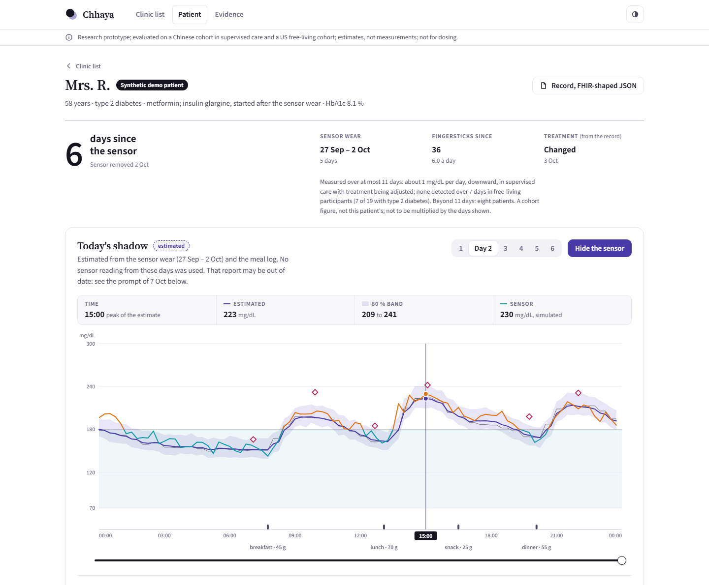
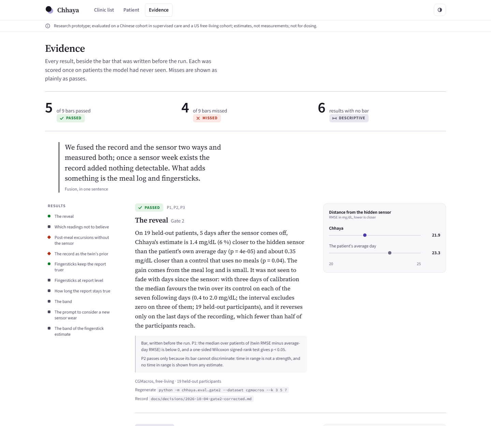
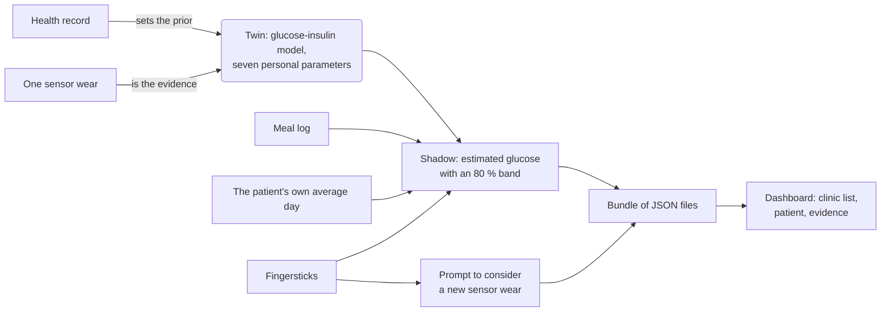

<div align="center">

# Chhaya

### A Type 2 diabetes digital twin that shows its work.

**One glucose-sensor wear, turned into the patient's shadow, with every claim scored once on held-out patients.**

**The brief says the future of medicine is proactive, not reactive. For a diabetes clinic in India that means this:** a sensor wear costs about Rs 4,400 to 5,100, so a patient wears one once and is treated from that report for months. Chhaya estimates the days nobody measured, draws the doubt as a band, and prompts when the report has probably gone stale.

[](LICENSE)


Entry to the **Happiest Health Digital Twin Challenge 2026** · Team **SynapseX** · D.B.S Kanpur · submission folder `SynapseX_D.B.S Kanpur`

**Start here:** [Problem Statement & Healthcare Use Case (PDF)](docs/Chhaya_Problem_and_Use_Case.pdf) · [Demo Video (YouTube Walkthrough)](https://youtu.be/TOn2xY_z5L8) · [Live Interactive Demo](https://digital-twin-hack.vercel.app/) · [Presentation Deck (PDF)](docs/Chhaya_Final_Presentation.pdf) · [Architecture Diagram (PDF)](docs/Chhaya_Architecture_Diagram.pdf)

[Problem & Use Case](#problem-statement) · [Demo Video](#demo-video) · [Compliance matrix](#challenge-compliance-matrix) · [Adverse events](#adverse-event-prediction) · [Results](#results-scoreboard) · [Dashboard](#the-clinician-dashboard) · [Architecture](#architecture) · [Technical Stack](#technical-stack) · [Deliverables](#submission-deliverables)

</div>

<p align="center"></p>

<p align="center"><sub><b>Mrs. R., a synthetic patient, on day 2 after her sensor came off.</b> Purple: Chhaya's estimate and its 80 % band, drawn without the sensor. Teal and amber: the real sensor, revealed on top. By day 6, after a change of treatment, the band holds 4 % of her readings and the dashboard raises a prompt to consider a new sensor wear. Both are in the demo; she is simulated and labelled so on screen.</sub></p>

## Problem Statement

About 101 million people in India live with diabetes (ICMR-INDIAB, 2023). Continuous glucose monitoring could guide their care, but one 14-day sensor costs roughly Rs 4,400 to 5,100. Wearing sensors all year would take about 26 of them, over Rs 1.1 lakh. So for many patients a sensor is worn once, a report is made, and the doctor treats from that report for months. Nobody tells the doctor how old the report has become, which of its readings not to believe, or what the patient’s glucose probably did after the sensor came off.

Given a health record and one sensor wear, Chhaya:
1. **Estimates the patient’s glucose after the sensor is removed**, with an honest uncertainty band;
2. **Labels sensor lows** that a fingerstick did not confirm;
3. **Prompts when the report has probably stopped describing the patient**; and
4. **Proves every claim on patients the model never saw**.

## Healthcare Use Case

The setting is outpatient follow-up of Type 2 diabetes, where the doctor holds a one-time sensor report and occasional fingersticks. The user is the treating clinician. The decision supported is whether the existing sensor report can still be relied on, or whether to consider a new sensor wear.

This is “proactive, not reactive” scoped to what we measured. On the dashboard the doctor sees:
- **The patient’s shadow**: an estimate with an 80 % band drawn without the sensor, with the real sensor revealed on top;
- **Fingerstick-updated estimates** and the health record that sets the twin’s prior;
- **The patient’s own meal-excursion history**;
- **Every result beside the bar written before it was run**.

Chhaya gives no dose advice, no low-glucose estimate and no alarm.

**What it does today:** Scored once on held-out patients against bars written beforehand, the estimate was 1.4 mg/dL closer to the hidden sensor than the patient’s own average day, five days after the sensor came off (19 CGMacros participants, 7 with type 2 diabetes, p = 4e-05). Fingersticks brought it 2.8 mg/dL closer (29 Shanghai patients in supervised care, about six fingersticks a day). Of nine pre-registered bars, five passed and four missed, and all nine are published. The evidence comes from a Chinese and a US cohort; no Indian patient data was used. This is a research prototype, not for dosing.

> 📄 **Standalone Deliverable:** A publication-ready 1-page executive summary PDF is available at [`docs/Chhaya_Problem_and_Use_Case.pdf`](docs/Chhaya_Problem_and_Use_Case.pdf).

## 60-Second Summary

| | |
|---|---|
| **Problem** | About 101 million people in India live with diabetes.[^1] One 14-day glucose-sensor wear costs roughly Rs 4,400 to 5,100 at retail,[^2] and wearing sensors continuously would take about 26 a year, over Rs 1.1 lakh at those prices. For many patients a one-time wear is the realistic pattern. The doctor then treats from that one report for months, and nobody tells them how old it has become. |
| **Solution** | Chhaya turns one sensor wear into the patient's *shadow*: a personalised glucose-insulin digital twin that starts from the health record, is fitted to the sensor week, and keeps estimating glucose afterwards from meals, wrist-band activity and fingersticks. Every estimate is drawn with an 80 % uncertainty band beside the word "estimated". |
| **Two streams, fused** | **Static:** a FHIR-shaped health record (demographics, diagnosis and duration, HbA1c, fasting glucose, BMI, medications; a genetic-marker field, synthetic, labelled and read by no model). **Dynamic:** the CGM sensor trace, meal log, wrist-band activity and fingersticks. The record sets the twin's prior, the sensor week is the evidence, and the record also feeds the excursion model as features. |
| **Adverse events predicted** | **1. Post-meal glucose excursion** (two consecutive readings above 180 mg/dL within 2 hours of a meal, the brief's own spike example), predicted at meal time on 47 held-out patients and 1,205 meals (39 % positive): AUROC 0.82 and AUPRC 0.76 with the live sensor, AUROC 0.71 and AUPRC 0.60 with the sensor off. A research model, not an alert: calibration and alert burden missed the bar. **2. A sensor report that has drifted** (mean glucose more than 20 mg/dL away): AUROC 0.82 (95 % interval 0.63 to 0.98) on 32 held-out recordings, surfaced only as a prompt to consider a new sensor wear. |
| **What we found about fusion** | Built two ways and measured both. Once a week of sensor data exists, the record added nothing detectable. The meal log and fingersticks are what add value; the fingerstick result was measured at about six a day in supervised care, and at one a day the running gain was 0.3 mg/dL. Reported as measured. |
| **Proof standard** | Nine bars were written before the runs: 5 passed, 4 missed, and the misses are published (one pass, P2, is flagged on screen as uninformative because its bar cannot discriminate). Every result was scored once on held-out patients (a half of each cohort that no setting was tuned on), with 400+ tests guarding against leakage. |
| **Run it** | Try the [live demo](https://digital-twin-hack.vercel.app/) directly in the browser, or run locally: `uv sync`, then `uv run python -m chhaya.dashboard` (opens http://127.0.0.1:8765). No datasets needed. |

**Reading paths.** 60 seconds: this summary and the compliance matrix. 5 minutes: [adverse-event prediction](#adverse-event-prediction) and the [dashboard](#the-clinician-dashboard). Full audit: [verify it yourself](#verify-it-yourself-in-five-minutes).

## Demo Video

**Full 15–20 Minute Walkthrough (Unlisted YouTube):** [https://youtu.be/TOn2xY_z5L8](https://youtu.be/TOn2xY_z5L8)

A comprehensive clinical and engineering walkthrough for the final evaluation jury of the Happiest Health Digital Twin Challenge 2026:
- **00:00 – 04:15** · *The Indian Clinical Reality:* The 351-day unmeasured blind spot, ₹1.1L/yr economic barrier, and high-carb glycemic volatility.
- **04:15 – 10:30** · *Live Clinician Dashboard Walkthrough:* Cohort triage queue, synthetic patient shadow infill, interactive carbohydrate what-if simulator, and evidence ledger.
- **10:30 – 15:45** · *Mathematical & Algorithmic Foundation:* JAX float64 two-compartment ODE, Bayesian MAP parameter identification, Laplace 200-member ensemble for the 80% credible band, and 1D Kalman innovation filter on sparse fingersticks.
- **15:45 – 20:00** · *Scientific Integrity Scoreboard:* 4-lock protocol, 5 passed bars, 4 missed bars, and responsible alert suppression under CDSCO Class B SaMD boundary.

## Challenge Compliance Matrix

Every requirement of the challenge brief, and where it is met.

| Challenge requirement | How Chhaya meets it | Where to look |
|---|---|---|
| Static / historical stream: simulated EHR (demographics, diagnoses, labs, genetic markers) | A FHIR-shaped record per patient (Patient, Condition, Observation with LOINC codes, MedicationStatement) built from the open datasets' demographics, diagnoses, labs and medications. The demo patient "Mrs. R." is synthetic and tagged so. The genetic-marker field is synthetic, labelled and read by no model: neither open dataset has genotypes | [`src/chhaya/product/record.py`](src/chhaya/product/record.py), dashboard "Record" panel |
| Dynamic stream: wearable / IoT time series (CGM, HRV, sleep, steps) | CGM traces from two open datasets, plus meal logs, wrist-band activity (Fitbit METs, CGMacros) and fingersticks (ShanghaiT2DM). The question is glucose-centred, so HRV and sleep stages are not used | [`src/chhaya/data/`](src/chhaya/data) |
| Fusion of the two streams | Bayesian fusion in the twin (the record's fasting glucose sets the basal-glucose prior, one of the twin's seven personal parameters; the sensor week is the likelihood) and feature-level fusion in the excursion model (13 record inputs, sensor-week history, fingersticks). Both measured | [Fusion](#fusion-what-we-built-and-what-we-measured) |
| A working algorithmic model that ingests both streams | JAX twin, logistic-regression excursion arms, fingerstick filter and drift prompt. Each reproduces with one command | [Reproduce everything](#reproduce-everything) |
| Predicts an adverse event | Post-meal glucose excursion and drifted sensor report, with numbers | [Adverse-event prediction](#adverse-event-prediction) |
| Conceptual UI dashboard showing how a doctor interacts with the virtual patient | Three screens: clinic list, the patient (health record, shadow, fingersticks, meal excursion history) and every result beside its bar. Offline, with a labelled meal what-if on the synthetic patient | [Dashboard](#the-clinician-dashboard) |
| Anonymised, open-source or synthetic data only | ShanghaiT2DM (CC BY 4.0), CGMacros (CC BY-NC-SA 4.0) and one synthetic patient. No credentialed data (for example MIMIC) is used. Datasets are fetched by checksum-verified script and never redistributed | [Data](#data-licences-and-governance) |
| Public GitHub repository | This repository | [github.com/AdityaChandel11/DigitalTwinHack](https://github.com/AdityaChandel11/DigitalTwinHack) |
| README: team and college, title, problem and use case, stack, AI/ML details | [Team](#team-details), title above, [problem](#problem-statement), [use case](#healthcare-use-case), [stack](#technical-stack), [model](#aiml-model-details) | |
| 15-20 minute Demo Video is uploaded as an Unlisted YouTube video and the link is added to the README | 20-minute video walkthrough covering clinical context, live dashboard, JAX math, pre-registration rigor, and outcomes | [https://youtu.be/TOn2xY_z5L8](https://youtu.be/TOn2xY_z5L8) |
| Architecture diagram (PDF/PPT format) | 3-page comprehensive technical architecture & AI/ML model card | [`docs/Chhaya_Architecture_Diagram.pdf`](docs/Chhaya_Architecture_Diagram.pdf) |
| Presentation in PDF/PPT format covering project details and outcomes | 10-slide high-density technical and clinical presentation | [PDF](docs/Chhaya_Final_Presentation.pdf) · [PPTX](docs/Chhaya_Final_Presentation.pptx) |
| Open-source licence details | MIT for code; dataset and font licences listed | [Licence](#open-source-licence) |
| All files and links publicly accessible without permissions | Public repository, unlisted video, live Vercel demo | [Deliverables](#submission-deliverables) |
| Folder name: Team Name_College Name | `SynapseX_D.B.S Kanpur` | [Deliverables](#submission-deliverables) |

## Problem Statement

A glucose digital twin normally relies on a sensor that stays on. In India it often cannot: at the price above, continuous wear is out of reach for many patients. So a patient wears a sensor once, gets a report, and is treated from that report for months. Nobody tells the doctor how old the report has become, which of its readings not to believe, or what the patient's glucose probably did after the sensor came off.

**Problem statement.** Given a health record and one sensor wear: (1) estimate the patient's glucose after the sensor is removed, with an honest uncertainty band; (2) say which sensor readings not to believe; (3) show what keeps the report true; (4) prompt when the report has probably stopped describing the patient; and prove every claim on patients the model never saw.

## Healthcare Use Case

- **Setting:** outpatient follow-up of Type 2 diabetes, where the doctor holds a one-time sensor report and occasional fingersticks.
- **User:** the treating clinician, not the patient.
- **Decision supported:** whether the existing sensor report can still be relied on, or whether to consider a new sensor wear.
- **What the doctor sees:** the shadow with its band beside the real trace; fingerstick-updated estimates; the treatment change since the sensor; a drift prompt shown only inside its tested range; a labelled meal what-if; every result beside its bar.
- **What Chhaya will not do:** give dose advice, estimate lows, or raise an alarm. See [what Chhaya is not](#what-chhaya-is-not).

## Fusion: What We Built and What We Measured

**How the streams meet**

1. **In the twin (Bayesian).** The record sets the prior of one of the twin's seven personal parameters, basal glucose, from the record's fasting glucose (a learned record-to-parameter map is future work). The sensor wear is the likelihood. Calibration is a MAP fit with a Laplace ensemble that produces the 80 % band.
2. **In the excursion model (feature level).** Thirteen patient-level record inputs (age, sex, BMI, diabetes duration, HbA1c, fasting and 2-hour postprandial glucose, C-peptide, eGFR, and four drug-class flags) join the sensor-week history features and the fingerstick features.

**What we measured**

| Test | Result | Reading |
|---|---|---|
| Record as the twin's prior (20 held-out CGMacros patients, one day of sensor data) | Changed the error by a median 0.02 mg/dL (p = 0.16); nothing measurable with three or more days | Missed its bar |
| Fused excursion model against the best single stream (47 held-out patients) | AUPRC 0.596 fused, 0.642 fingersticks only, 0.626 sensor history only | Fusion did not beat the best single stream |
| Record alone, no sensor at all | AUROC 0.65 for who tends to spike, calibration slope 0.52 (overconfident) | Weak but above chance: the only stream available before any sensor is worn |
| Meal log (Gate 2: 19 held-out free-living CGMacros participants, 7 with type 2 diabetes) | Estimate 1.4 mg/dL (6 %) closer to the hidden sensor than the patient's own average day | Passed; small |
| Fingersticks (29 held-out ShanghaiT2DM patients in supervised care, tested about six times a day) | 2.8 mg/dL closer as they arrive, 9.5 in hindsight; at one fingerstick a day the running gain was 0.3 mg/dL | Passed, at that testing frequency only |

Fusion, in one sentence: once a sensor week exists, the record added nothing detectable; what adds something is the meal log and fingersticks.

## Adverse-Event Prediction

The brief's example is predicting a glucose spike in advance. Chhaya tests exactly that, on real patients, and reports what a plain baseline can do.

**Task.** At the moment a meal starts, predict whether two consecutive sensor readings will exceed 180 mg/dL within the next 120 minutes. Data: ShanghaiT2DM, 47 held-out patients, 1,205 meals, 39.2 % positive. Models: logistic-regression pipelines on five input sets, plus a plain personal-rate baseline. Scored once.

| Input set | AUPRC | AUROC | Calibration slope | Within-patient AUROC (20 patients) |
|---|---|---|---|---|
| Record only | 0.566 | 0.646 | 0.52 | 0.622 |
| Sensor history only | 0.626 | 0.777 | 0.86 | 0.623 |
| Fingersticks only | 0.642 | 0.703 | 1.00 | 0.568 |
| **Fused, sensor off** | **0.596** | **0.713** | 0.48 | 0.622 |
| **Sensor on (reference)** | **0.760** | **0.816** | 0.77 | 0.780 |
| Personal excursion rate, plain share (registered baseline) | 0.587 | 0.756 | n/a | 0.512 |

Prevalence is 0.39, so every row is above chance. What this says, plainly:

- **With the live sensor the excursion is predictable at meal time** (AUROC 0.82, AUPRC 0.76, within-patient AUROC 0.78). Most of the sensor-on advantage comes from the 164 meals that start already above 180 mg/dL.
- **Without the sensor, the models know who spikes better than when.** Overall, the patient's own excursion rate (AUPRC 0.587) matches the fused model (0.596). Within a patient every sensor-off model sits between AUROC 0.57 and 0.62 (the personal rate, which cannot vary within a patient, is 0.51); only the live sensor lifts it, to 0.78.
- **Fusion did not beat the best single stream.** Fused minus sensor history only: -0.030 AUPRC (95 % interval -0.095 to 0.052).
- **It is not usable as an alert.** At the threshold that gives 80 % sensitivity on development meals, test sensitivity was 86 % with 8.9 false alerts per patient-week against 21.4 eligible meals per patient-week. The fused probabilities are overconfident (calibration slope 0.48), so the dashboard does not show an excursion alert.
- **A different learner does not change the picture.** LightGBM at library defaults on the fused inputs: AUPRC 0.623, AUROC 0.761.
- **Obvious fusion alternatives did not help either (exploratory).** On the 49 development patients only (the held-out set was not touched), late fusion, stacking and stronger regularisation did not beat the best single stream (stacking came within 0.005 AUPRC), and a Platt recalibration did not bring the calibration slope into range. Not a registered result; reproduce with python exploratory/run.py, see exploratory/REPORT.md.

**Second adverse event: a drifted sensor report.** On 32 held-out recordings (29 patients, up to eleven days after a three-day sensor report), 11 drifted by more than 20 mg/dL in mean sensor glucose. A running sum of fingerstick surprises separated drifted from stable recordings with AUROC 0.82 (95 % interval 0.63 to 0.98). At a threshold set on development recordings so that at most 10 % of stable ones would raise it, it was raised in 7 of 11 drifted recordings and 2 of 21 stable ones. Comparing the plain fingerstick average with the report did as well (0.82). It is a prompt about the report, never a finding about the patient.

Full records: [Gate 3](docs/decisions/2026-10-08-gate3.md) and [staleness](docs/decisions/2026-10-08-staleness.md). Regenerate with `python -m chhaya.eval.gate3` (development patients; the confirmatory run needs `--confirm` and refuses a second run by design).

## Results Scoreboard

Each result was scored once on held-out patients, a half of each cohort that no setting was ever tuned on. This table is a summary; each claim's full wording, with its caveats, is in the next section.

| | Result | Bar written beforehand | Outcome |
|---|---|---|---|
| **The reveal** | Five days after the sensor comes off, the estimate is 1.4 mg/dL (6 %) closer to the hidden sensor than the patient's own average day (p = 4e-05, 19 participants). The gain comes from the meal log and is small | Closer than the average day, p < 0.05 | **Passed** |
| **Fingersticks keep the report truer** | 2.8 mg/dL closer to the hidden sensor as fingersticks arrive, 9.5 in hindsight, 0.3 with one a day (29 patients) | Closer than the daily shape alone, p < 0.05 | **Passed** |
| **Which readings not to believe** | 8 of 64 sensor lows were confirmed by a fingerstick taken within 10 minutes; 732 of 809 sensor highs were | none | Descriptive |
| **Post-meal excursions without the sensor** | Fusing the record, the sensor week and fingersticks reaches AUPRC 0.60. The patient's own excursion rate reaches 0.59, fingersticks alone 0.64 (47 patients) | Fusion beats every single stream and the personal rate | **Missed** |
| **The record as the twin's prior** | It changed the error by 0.02 mg/dL with one day of sensor data (p = 0.16, 20 participants) | Lower error with the record, p < 0.05 | **Missed** |
| **Fingersticks at report level** | Our rebuilt report missed mean glucose by 8.9 mg/dL. The plain fingerstick average on the sensor's scale missed by 6.4; the stale three-day report by 13.0 | none | Descriptive: a plain baseline beats us |
| **How long a report stays true** | About 1 mg/dL per day, downward, over at most eleven days in supervised care; none detected over a week in free-living participants. These data do not give a number of days | none | Descriptive |
| **The 80 % band of the twin** | It held 83.5 % of hidden readings on average and 60 % to 98.5 % for an individual. A recalibration did not transfer and is not used | none | Descriptive |
| **The band of the fingerstick estimate** | It held 83.6 % of hidden sensor readings (49.9 % to 98.9 % for an individual) at about 45 mg/dL each side: right on average, and wide | none | Descriptive |
| **A prompt to consider a new sensor wear** | It told drifted from stable reports with AUROC 0.82 (interval 0.63 to 0.98). Comparing the fingerstick average with the report did as well (0.82) | none | Descriptive: a plain baseline does as well |

Bars and their dated amendments: [docs/PREREGISTRATION.md](docs/PREREGISTRATION.md).

**Fusion, in one sentence:** we fused the record and the sensor two ways and measured both; once a sensor week exists the record added nothing detectable. What adds something is the meal log and fingersticks.

**What the misses changed in the product**

- The excursion model missed its bars, so the dashboard shows no meal alert and no probability. It shows the patient's own recorded excursion history instead, labelled as history.
- The record's prior added nothing measurable, so the record panel says "With sensor data, the sensor dominates." and the product claims no benefit from the record.
- A plain baseline matched the drift check, so it appears only as a prompt about the report, inside its tested range, never as a finding about the patient.

## The Clinician Dashboard

Three screens, built to be read in ten seconds by a doctor: **who has an old sensor report**, **what one patient's shadow looks like beside the real trace**, and **every result beside its bar, misses included**. It runs offline from pre-computed files; nothing is fitted while it runs.

```bash
uv sync
uv run python -m chhaya.dashboard        # opens http://127.0.0.1:8765, no datasets needed
```

<p align="center"></p>

- **Honest uncertainty is the design.** An estimate is never drawn without its band and the word "estimated". A sensor low reads "sensor low, unconfirmed", because most were not.
- **The reveal is the interaction.** The shadow comes first; the real sensor then slides over it.
- **One panel per stream, plus the shadow.** The patient screen shows *From the health record* (the record that sets the twin's prior), *Today's shadow*, *Fingersticks*, and *Meal excursion history*: how often each meal type was followed by a reading above 180 mg/dL within two hours during the sensor wear. The history reads only the calibration window, so no hidden-day sensor reading ever reaches it, and a test checks that. It is a description of the wear, not a forecast.
- **No dose advice, no low-glucose estimate, no alarm.** The prompt to consider a new sensor wear is a prompt about the report, never a finding about the patient.
- With the datasets and the cache built locally, `python -m chhaya.build --real --confirm` adds every held-out patient (49 in all) to a private local bundle.

## Architecture

A text-and-diagram view of the system; the same diagram is in the architecture PDF listed under [deliverables](#submission-deliverables).



- **The twin** is the published E-DES glucose-insulin model with a circadian term, in JAX, with seven personal parameters. The record sets the prior of one of them, basal glucose; the sensor wear is the likelihood. Calibration is a MAP fit with a Laplace ensemble for the band.
- **The estimate is a blend**: half physiology, which knows what was eaten today, and half the patient's own average day, which knows the habits a meal log misses.
- **Fingersticks** nudge the estimate through a filter whose effect fades over about two hours, and feed a running comparison with the sensor wear's daily pattern. Its band is the filter's own spread, scaled by the patient's own spread about their daily shape.

| Layer | What it does | Code |
|---|---|---|
| Data | Checksum-verified download, loaders and audit for two open datasets; a label-validity check of sensor lows and highs against fingersticks | `src/chhaya/data/` |
| Twin | E-DES-based glucose-insulin model in JAX, record-informed prior, MAP calibration with Laplace ensemble, fingerstick assimilation, drift prompt | `src/chhaya/twin/` |
| Evaluation | Pre-registered experiments, patient-level splits, once-only confirmatory runs, descriptive outputs | `src/chhaya/eval/` |
| Product | FHIR-shaped record, synthetic patient, meal what-if, claim and wording registry tested word for word against the decision records | `src/chhaya/product/` |
| Dashboard | Static page plus a pre-computed JSON bundle; nothing is fitted while it runs | `src/chhaya/dashboard/` |

## Technical Stack

| Area | Technology | Role |
|---|---|---|
| Language and tooling | Python 3.12 to 3.13, uv, pytest (400+ tests), ruff | Reproducible environment, tests, linting |
| Twin core | JAX (float64), NumPy, SciPy | Glucose-insulin ODE model, MAP calibration, Laplace ensemble |
| Event models | scikit-learn (logistic regression, GroupKFold), LightGBM | Excursion arms and a learner sensitivity check |
| Data handling | pandas, PyArrow, openpyxl, xlrd, requests | Loaders for the open datasets, checksum-verified download |
| Interoperability | FHIR-shaped Bundle (Patient, Condition, Observation with LOINC codes, MedicationStatement) | The static record stream |
| Dashboard | Python standard-library HTTP server, static HTML, CSS and vanilla JavaScript; JSON bundle | Offline clinician interface; static export for hosting |
| Typography | Source Sans 3, Source Serif 4, Source Code Pro (SIL OFL 1.1) | Dashboard fonts, licence included |

## AI/ML Model Details

1. **Physiological twin.** The structure follows E-DES, the Eindhoven Diabetes Education Simulator (Maas et al., 2015), in the CGM-calibrated form of Erdős et al.: gut, plasma glucose, plasma insulin with glucose-driven endogenous secretion, and interstitial glucose. Added here: a circadian term on hepatic output and an exercise term on insulin-dependent uptake. Seven personal parameters per patient; prior from the health record; calibration by MAP fit on the sensor days; an 80 % predictive band from a Laplace ensemble.
2. **The estimate is a blend:** half physiology, which knows what was eaten today, and half the patient's own average day, which knows the habits a meal log misses.
3. **Fingerstick assimilation.** A filter whose effect fades over about two hours nudges the running estimate; its band is the filter's own spread scaled by the patient's own spread about their daily shape.
4. **Excursion models.** Logistic-regression pipelines (impute, scale, fit) on five input sets: record, sensor history, fingersticks, fused, sensor on. Patient-grouped cross-validation on development patients; one confirmatory run on test patients.
5. **Drift prompt.** A running sum of fingerstick surprises with thresholds set on development recordings, shown only inside its tested range.
6. **Uncertainty and interpretability.** Seven named physiological parameters, an 80 % band on every estimate (83.5 % coverage on average, 60 % to 98.5 % for an individual), and the real sensor revealed over the shadow. Both bands are calibrated on average, not per patient.

## Evaluation Methodology and Integrity

Every result follows one protocol. Patients are split by patient, never by row: one half tunes every setting, the other half is scored once, by a command that needs `--confirm` and committed code. Uncertainty is a 95 % interval from a bootstrap over patients (2,000 resamples in Gate 3). Metrics fit the question: RMSE against the hidden sensor, AUPRC and AUROC for events, calibration slope, net benefit and false alerts per patient-week, and coverage for bands.

These rules are what separate this from a model validated on its own simulator. They are in [docs/PROJECT_GUIDE.md](docs/PROJECT_GUIDE.md) and enforced by tests.

1. **No leakage.** In the hidden window the twin may read meals, a wrist band and fingersticks, never the sensor. Every evaluation asserts that scored readings lie after the calibration split, and every feature builder has a test that changes the hidden sensor and checks that nothing else moves.
2. **Split by patient, never by row.** One half of the patients tunes every setting; the other half is scored once, by a command that needs `--confirm` and committed code.
3. **Bars are written before the run.** Changing one afterwards means a dated amendment that says so.
4. **Misses are published.** A failed fit is a row with an error, not a dropped patient.
5. **Every claim is checked against its record.** The sentences on the Evidence screen are tested word for word against the decision records in [docs/decisions/](docs/decisions/).
6. **Synthetic is labelled synthetic.** The demo patient "Mrs. R." and any genetic-marker field are simulated; neither open dataset has genotypes.

## Responsible Use, Safety and Limitations

**Research prototype. Not a medical device. Not for clinical decisions.** Built on open datasets and one synthetic patient for the Happiest Health Digital Twin Challenge 2026.

### What Chhaya is not
- It does not replace a sensor. Against the next fingerstick the estimate is about 22 % off where a real sensor is about 12 %.
- It has no low-glucose estimate and raises nothing on lows: in the open data most sensor lows were not confirmed by a fingerstick.
- It recommends no dose. The dashboard only simulates a meal the doctor enters.
- It shows no time in range from an estimate, and no HbA1c from fingersticks.
- It does not claim that fusing the record with the sensor improves anything we measured.
- It gives no rule for when a patient should wear a sensor again.

### Limits

No Indian data. Shanghai is supervised care with treatment being adjusted. Hidden windows are at most eleven days, plus eight patients recorded again up to 168 days later (a case series, not a rule). The effect of the physiology is about 2 %. The prompt was not shown to do better than comparing the fingerstick average with the report, and was not tested in outpatient care. Both bands are calibrated on average, not per patient, and the fingerstick band is wide. The model has no exogenous insulin, no drug kinetics and no counter-regulation. The Clarke error grid used in the fingerstick experiment is the widely used reference implementation, not checked against the 1987 figure.

## Data, Licences and Governance

Code: MIT. Datasets are downloaded by the user and never redistributed; only derived aggregates are in this repository.

- **ShanghaiT2DM**: 100 patients with Type 2 diabetes, 109 recordings, supervised care. CC BY 4.0 (Zhao et al., Scientific Data 2023).
- **CGMacros**: 45 free-living participants. CC BY-NC-SA 4.0, non-commercial use only (PhysioNet, doi 10.13026/3z8q-x658).
- **Fonts** in the dashboard (Source Sans 3, Source Serif 4, Source Code Pro): SIL Open Font License 1.1, in [`OFL.txt`](src/chhaya/dashboard/static/fonts/OFL.txt).

### What we used and keep private, and why

Some of what went into this project is deliberately not in the repository. Each item is named here so nothing is hidden by omission.

| What | What we used it for | Why it is not published |
|---|---|---|
| **The two datasets** (`data/`) | Everything: calibration, scoring, the label check | Not ours to redistribute. CGMacros is CC BY-NC-SA, non-commercial; ShanghaiT2DM is CC BY 4.0 but we fetch both by script, with checksums, rather than copy them. `python -m chhaya.data.download` brings them in |
| **Per-reading traces of real patients** (`data/derived/traces`, `artifacts/`) | The held-out patients on the local dashboard, and the by-day results | Per-reading data of real people is patient data, not an aggregate. Only derived aggregates are committed (`results/`). The committed demo bundle and any hosted copy carry the synthetic patient only |
| **Real names** | Nowhere | The datasets contain none. Names on screen are pseudonyms given by Chhaya, with the dataset's own identifier beside them, and the dashboard says so |
| **Local tooling settings** | Writing and reviewing the code with AI-assistant tools | Editor and tool configuration and third-party helper files with their own licences: tooling, not method. Every decision they helped with is written up in `docs/decisions/`, and the rules the work followed are public in `docs/PROJECT_GUIDE.md` |

## Reproduce everything

```bash
uv sync
uv run pytest -q                                           # the full suite
uv run python -m chhaya.data.download shanghai cgmacros    # 3.7 MB + 627 MB, checksum-verified
uv run python -m chhaya.data.audit                         # dataset counts and the label check
uv run python -m chhaya.eval.gate2 --dataset cgmacros --k 3 5 7
```

Each later result has one command. It reads held-out patients only with `--confirm`, once, on committed code; the results are in `results/`.

```bash
uv run python -m chhaya.eval.gate3 --confirm                 # post-meal excursions: missed its bars
uv run python -m chhaya.eval.fusion                          # the record as the twin's prior: missed
uv run python -m chhaya.eval.fingersticks --confirm          # fingersticks after the sensor: passed
uv run python -m chhaya.eval.fingersticks_report --confirm   # the same, at the level of a sensor report
uv run python -m chhaya.eval.expiry shanghai --confirm       # also: cgmacros, cases
uv run python -m chhaya.eval.calibrate --confirm             # the twin band's recalibration: did not transfer
uv run python -m chhaya.eval.stickband --confirm             # the band of the fingerstick estimate
uv run python -m chhaya.eval.staleness --confirm             # the prompt to consider a new sensor wear
uv run python -m chhaya.build                                # the dashboard's demo bundle
uv run python -m chhaya.build --real --confirm               # plus every held-out patient, kept local
uv run python -m chhaya.dashboard                            # the dashboard
```

## Verify It Yourself in Five Minutes

1. `uv sync`, then `uv run python -m chhaya.dashboard`. Open the Evidence screen: every result sits beside the bar written for it, misses included.
2. Read [`docs/PREREGISTRATION.md`](docs/PREREGISTRATION.md) (the bars and their dated amendments), then the matching record in [`docs/decisions/`](docs/decisions/).
3. Open any `results/**/provenance.json`: it records the commit and settings of the run. `git cat-file -t <commit>` confirms the commit is in this repository's history.
4. `uv run pytest -q` (several minutes). The leakage tests change the hidden sensor and assert that nothing else moves.
5. With the datasets (`python -m chhaya.data.download shanghai cgmacros`), regenerate any development run. Confirmatory runs refuse a second run by design.

## Repository map

- `src/chhaya/` the package: data loaders, the twin (model, calibration), evaluation, the dashboard build and server
- `tests/` the test suite; synthetic patients with known true parameters
- `results/` every reported number, as written by the commands above
- `docs/PREREGISTRATION.md` the bars, fixed before each run, with dated amendments
- `docs/decisions/` one record per result, each with its "claim to quote"
- `docs/PROJECT_GUIDE.md` the project's rules and conventions

## Submission Deliverables

| Deliverable | Format / Resource | Where to find |
|---|---|---|
| **Public GitHub Repository** | Source code & documentation | [github.com/AdityaChandel11/DigitalTwinHack](https://github.com/AdityaChandel11/DigitalTwinHack) |
| **Problem Statement & Use Case** | Executive Brief (PDF, 1 page) | [`docs/Chhaya_Problem_and_Use_Case.pdf`](docs/Chhaya_Problem_and_Use_Case.pdf) |
| **15–20 min Demo Video** | Unlisted YouTube Walkthrough | [https://youtu.be/TOn2xY_z5L8](https://youtu.be/TOn2xY_z5L8) |
| **Architecture Diagram** | PDF (3 pages, complete model card) | [`docs/Chhaya_Architecture_Diagram.pdf`](docs/Chhaya_Architecture_Diagram.pdf) |
| **Presentation Deck (PDF)** | Vector PDF (10 slides, high density) | [`docs/Chhaya_Final_Presentation.pdf`](docs/Chhaya_Final_Presentation.pdf) |
| **Live Interactive Clinician Demo** | Next.js 14 Web Application | [https://digital-twin-hack.vercel.app/](https://digital-twin-hack.vercel.app/) |
| **Open-Source Licence** | MIT License | [`LICENSE`](LICENSE) |
| **Submission Folder Name** | Required naming format | `SynapseX_D.B.S Kanpur` |
| **College / Institution** | Academic affiliation | D.B.S. College, Kanpur |
| **Team Name & Lead** | Solo Entry | Team SynapseX (Aditya Singh Chandel) |

The hosted demo is a static export (`python -m chhaya.dashboard --export DIR`). Only the synthetic demo bundle is ever exported.

## Team Details

**Team SynapseX** · solo entry · D.B.S. College, Kanpur (D.B.S Kanpur) · team lead and developer: Aditya Singh Chandel.

The team lead's contact details are submitted on the challenge platform, as the rules require. AI-assistant tools were used to write and review code; every decision they helped with is written up in [`docs/decisions/`](docs/decisions/) and the rules the work followed are in [`docs/PROJECT_GUIDE.md`](docs/PROJECT_GUIDE.md).

## Open-Source Licence

- **Code:** MIT, see [`LICENSE`](LICENSE).
- **Datasets:** not covered by the MIT licence and never redistributed here. ShanghaiT2DM is CC BY 4.0; CGMacros is CC BY-NC-SA 4.0 (non-commercial).
- **Fonts:** SIL Open Font License 1.1, see [`OFL.txt`](src/chhaya/dashboard/static/fonts/OFL.txt).

## References

- Maas AH et al. A physiology-based model describing heterogeneity in glucose metabolism: the core of the Eindhoven Diabetes Education Simulator (E-DES). *J Diabetes Sci Technol* 2015;9:282-292. [PMC4604593](https://pmc.ncbi.nlm.nih.gov/articles/PMC4604593)
- Erdős B et al. Leveraging continuous glucose monitoring for personalized modeling of insulin-regulated glucose metabolism. *Scientific Reports*.
- Zhao Q et al. Chinese diabetes datasets for data-driven machine learning (ShanghaiT1DM and ShanghaiT2DM). *Scientific Data* 2023. [PMC9849330](https://www.ncbi.nlm.nih.gov/pmc/articles/PMC9849330/)
- CGMacros: a scientific dataset for personalized nutrition and diet monitoring. PhysioNet, [doi 10.13026/3z8q-x658](https://physionet.org/content/cgmacros/).

**Keywords:** digital twin, Type 2 diabetes, continuous glucose monitoring (CGM), electronic health record (EHR), FHIR, wearable, fingerstick, glucose-insulin model, E-DES, JAX, Bayesian calibration, uncertainty quantification, pre-registration, held-out validation, clinical decision support, India.

[^1]: Anjana RM et al., ICMR-INDIAB national cross-sectional study, *The Lancet Diabetes & Endocrinology*, 2023, [doi:10.1016/S2213-8587(23)00119-5](https://doi.org/10.1016/S2213-8587(23)00119-5): 101 million people with diabetes (11.4 %) and 136 million with prediabetes, from 113,043 participants surveyed between 2008 and 2020.
[^2]: Retail listings checked on 11 October 2026. FreeStyle Libre sensor: selling price Rs 4,437 (MRP Rs 4,671) on [Truemeds](https://www.truemeds.in/otc/freestyle-libre-sensor-system-1-tm-heca1-001451). FreeStyle Libre 2 sensor: Rs 4,624 to 5,138 in [Amazon India price history](https://www.pricebefore.com/abbott-freestyle-libre-2-plus-sensor-p842640.html). Prices vary by model and seller.

## Appendix: The Claims in Full

<details>
<summary><b>The reveal</b> (Gate 2, passed)</summary>

On 19 held-out patients, 5 days after the sensor comes off, Chhaya's estimate is 1.4 mg/dL (6 %) closer to the hidden sensor than the patient's own average day (p = 4e-05) and about 0.35 mg/dL closer than a control that uses no meals (p = 0.04). The gain comes from the meal log and is small. It was not seen to fade with days since the sensor; with three days of calibration the median favours the twin over its control on each of the seven following days (0.4 to 2.0 mg/dL; the interval excludes zero on three of them; 19 held-out participants), and it reverses only on the last days of the recording, which fewer than half of the participants reach.

Records: [Gate 2, corrected run](docs/decisions/2026-10-04-gate2-corrected.md), [expiry](docs/decisions/2026-10-08-expiry.md). Time in range is not a strength of the estimate and is never shown from it.
</details>

<details>
<summary><b>Which readings not to believe</b> (label check, descriptive)</summary>

Of 64 sensor readings below 70 mg/dL with a fingerstick within 10 minutes, 8 (12.5 %) were confirmed, and 0 of 9 at night; of 809 sensor readings above 180, 732 (90.5 %) were confirmed.

Regenerate: `python -m chhaya.data.audit`. This is why Chhaya has no low-glucose estimate and why a sensor low on its screens reads "sensor low, unconfirmed".
</details>

<details>
<summary><b>Fingersticks</b> (passed)</summary>

On 29 held-out Shanghai patients, calibrated on three days of sensor data, fingersticks taken afterwards brought the running estimate 2.8 mg/dL closer to the hidden sensor than the patient's daily shape alone (median paired RMSE difference; 95 % interval 1.6 to 4.7; 86 % of patients; p = 4e-06) and 9.5 mg/dL closer in hindsight (interval 4.6 to 12.1); with one fingerstick a day the running gain was 0.3 mg/dL.

To be told with it: the filter was chosen on development patients by a criterion other than the plan's written rule (dated note in the registration, before the test run), and the estimate is still about 22 % off the next fingerstick where a real sensor is about 12 %. Record: [fingersticks](docs/decisions/2026-10-08-fingersticks.md).
</details>

<details>
<summary><b>Post-meal excursions without the sensor</b> (Gate 3, missed its bars)</summary>

On 47 held-out Shanghai patients (1,205 meals, 39 % followed by an excursion above 180 mg/dL), a model fusing the record, the sensor week and fingersticks predicted the excursion at meal time with AUPRC 0.60, which was not better than any single stream (fingersticks only: 0.64) nor than the patient's own excursion rate from the sensor week (0.59; difference 0.01, 95 % interval -0.09 to 0.14); with the sensor on, the same model reaches 0.76.

Record: [Gate 3](docs/decisions/2026-10-08-gate3.md). There is no meal alert.
</details>

<details>
<summary><b>The record as the twin's prior</b> (missed its bar)</summary>

On 20 held-out CGMacros patients with one day of sensor data, giving the twin the record's fasting glucose as its prior changed the error of the estimate by a median of 0.02 mg/dL (p = 0.16), and with three or more days by nothing measurable: the record, as it enters the twin today, is not worth any sensor days.

Record: [record prior](docs/decisions/2026-10-08-record-prior.md).
</details>

<details>
<summary><b>Fingersticks at report level</b> (descriptive; a plain baseline beats our estimator)</summary>

On 29 held-out Shanghai patients under supervised care who were tested about six times a day, with the hidden sensor as the yardstick, a three-day sensor report missed the mean sensor glucose of the following days (up to eleven) by a median of 13.0 mg/dL. Chhaya's report rebuilt in hindsight from those fingersticks missed it by 8.9 (median paired difference 3.4, 95 % interval 1.6 to 8.9, 83 % of patients), but was no closer than the plain average of the same fingersticks converted to the sensor's scale by a line learned during the wear (6.4). The share of those converted readings above 180 mg/dL and within 70 to 180 was also closer to the sensor's time above 180 and time in range (3.1 against 8.8 points; 5.0 against 15.2). As read from the meter the same average lay 18.3 mg/dL from the sensor's mean; sensor-scale figures are not meter values. Lower testing frequencies were not measured, and this is not a recommendation to test at any frequency.

Record: [fingersticks at report level](docs/decisions/2026-10-08-fingersticks-report.md).
</details>

<details>
<summary><b>How long a report stays true</b> (expiry, descriptive)</summary>

"Report" means mean glucose only, and a three-day report stands in for a fourteen-day one. On 47 held-out Shanghai patients under supervised care with treatment being adjusted, a day's mean sensor glucose lay a median of 13.5 mg/dL from a three-day sensor report's mean inside the wear and 11 to 16 on the four days after it; inside each patient that distance grew by 1.0 mg/dL per day (95 % interval 0.7 to 2.6) over at most eleven days, with glucose moving downward. On 19 held-out free-living CGMacros participants (7 with type 2 diabetes; medication not recorded) no growth was detected over seven days (0.1 mg/dL per day, interval -0.8 to 0.8). In a case series of eight Shanghai patients recorded again (nine later wears, five beginning within three days of the first sensor coming off and four 33 to 154 days after it), four wears in three patients had a mean more than 20 mg/dL lower, all four with a change of treatment in the files; of the five that had not moved, four had no change and one had, and the old daily profile fitted them no worse than a fresh one. No test; not a rule for when a patient should wear a sensor.

Record: [expiry](docs/decisions/2026-10-08-expiry.md).
</details>

<details>
<summary><b>The 80 % band of the twin</b> (descriptive; the recalibration did not transfer)</summary>

On 19 held-out participants the 80 % band held 83.5 % of hidden readings on average and between 60 % and 98.5 % for an individual, with 10 of 19 participants within 70 to 90 %. A recalibration factor chosen on development patients (0.78) moved the average to 75.7 %, further from 80 % than before, so it is not used: the band is calibrated on average, not per patient.

Record: [band](docs/decisions/2026-10-08-band.md).
</details>

<details>
<summary><b>The band of the fingerstick estimate</b> (descriptive)</summary>

Descriptive, no bar. On 29 held-out Shanghai patients under supervised care, calibrated on three days of sensor data and tested about six times a day, a band built from the fingerstick filter's own spread and each patient's spread during the sensor wear, with nothing fitted, held 83.6 % of hidden sensor readings around the running estimate (49.9 % to 98.9 % for an individual; 12 of 29 patients within 70 to 90 %) and 86.1 % around the estimate in hindsight (56.7 % to 100 %), at a half-width of about 45 mg/dL. It is calibrated on average, not per patient, and it is wide.

Record: [stickband](docs/decisions/2026-10-09-stickband.md).
</details>

<details>
<summary><b>A prompt to consider a new sensor wear</b> (descriptive; a plain baseline does as well)</summary>

On 32 held-out Shanghai recordings (29 patients under supervised care, tested about six times a day, for up to eleven days after a three-day sensor report), 11 of which drifted by more than 20 mg/dL in mean sensor glucose (9 downward, 2 upward), a running sum of fingerstick surprises, used only as a prompt to consider a new sensor wear, separated drifted from stable recordings with AUROC 0.82 (95 % interval 0.63 to 0.98), against 0.82 (0.61 to 0.97) for the plain fingerstick average compared with the report's mean (difference 0.00, interval -0.16 to 0.18): it was not shown to do better than that comparison. At a threshold set on development recordings so that at most 10 % of stable ones would raise it, the prompt was raised in 7 of 11 drifted recordings (64 %) and 2 of 21 stable ones (10 %); in those 7, a median of 2.6 days after the split. With a five-day report (24 recordings, 6 drifted) it was not shown to separate them (0.67, interval 0.35 to 0.92). The label and the score look back over the same days. It is not a finding about a patient's glucose, not advice on treatment and not a rule for when to wear a sensor, and it was not tested in outpatient care, at lower testing frequencies or over longer periods.

Record: [staleness](docs/decisions/2026-10-08-staleness.md).
</details>
